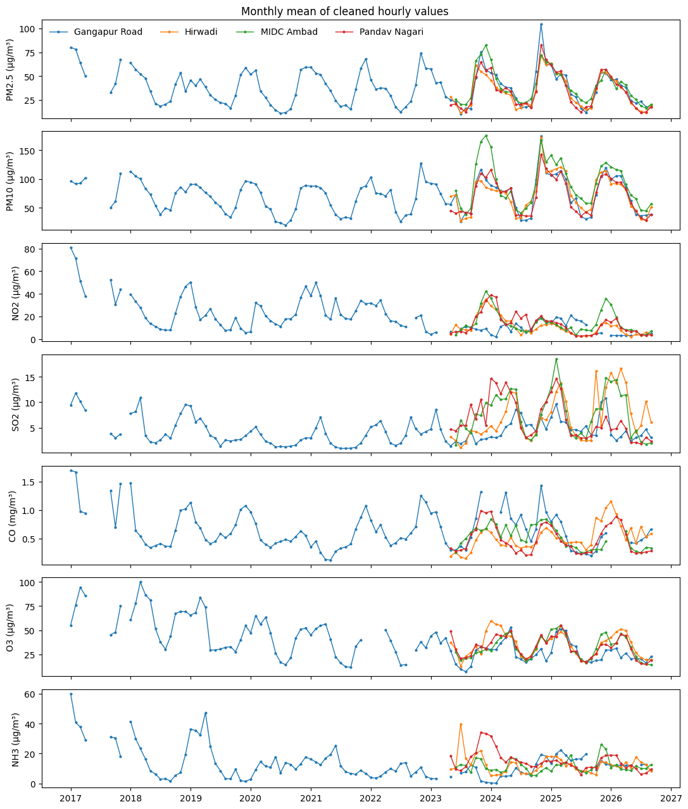
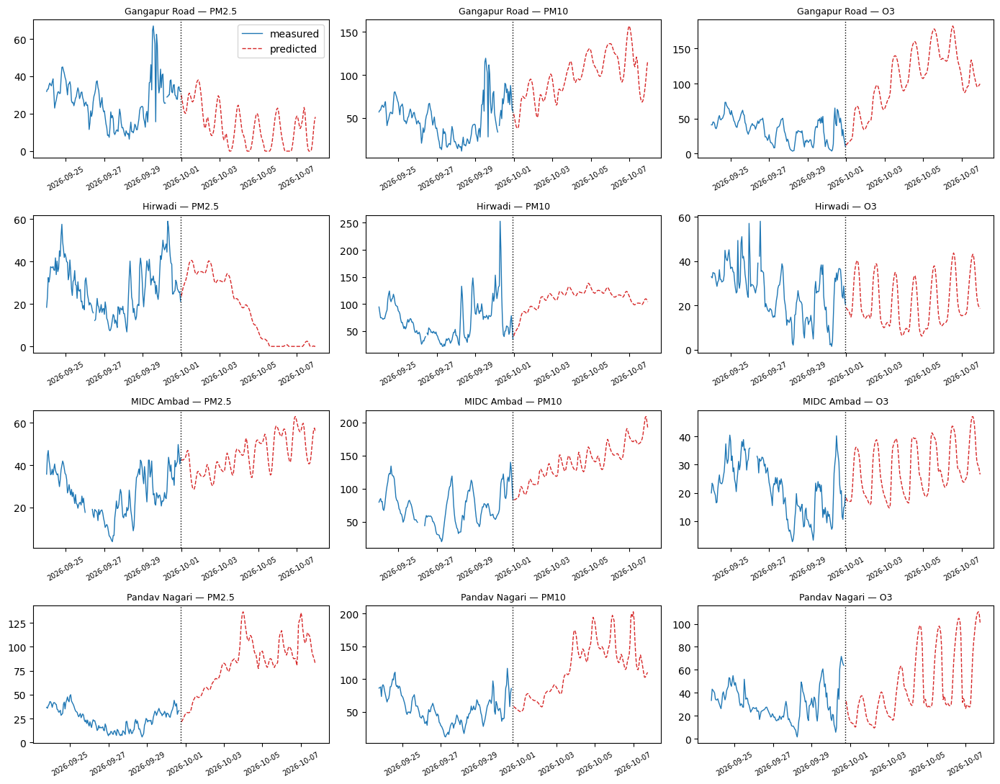
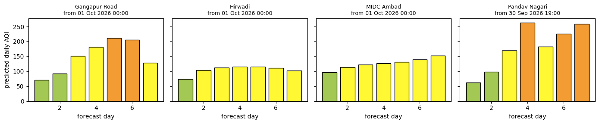
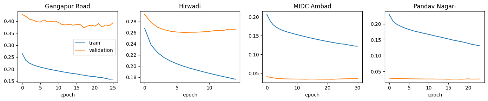

# Nashik Air Quality: 7-Day CNN-LSTM Forecast and CPCB Daily AQI

[](https://colab.research.google.com/github/parth-sharma-10/nashik-aqi-7day-forecast/blob/main/Nashik_AQI_CNN_LSTM_7DAY.ipynb)

A CNN-LSTM forecasts the next **7 days (168 hours)** of seven air pollutants (PM2.5, PM10, NO₂,
SO₂, CO, O₃, NH₃) at four CPCB monitoring stations in Nashik, Maharashtra. The hourly
forecast is then converted into **7 daily CPCB AQI values** per station.

Everything is in one notebook, [`Nashik_AQI_CNN_LSTM_7DAY.ipynb`](Nashik_AQI_CNN_LSTM_7DAY.ipynb),
with 13 short code cells that run top to bottom. The notebook in this repository has already
been run, so all outputs and plots are visible without running it.

> **Result in one line:** the pipeline works end to end and is verified, but the 7-day
> recursive forecast is **less accurate than simple baselines** on held-out data (see
> [Results](#results)). Treat the forecast AQI as a demonstration of the method, not a
> reliable outlook.

---

## Repository contents

```
Nashik_AQI_CNN_LSTM_7DAY.ipynb      notebook (executed, with outputs)
data/
  gangapur_road_nashik.csv          hourly data, one file per station
  midc_ambad_nashik.csv
  hirwadi_nashik.csv
  pandav_nagari_nashik.csv
outputs_7day/
  recursive_forecast_7day_hourly.csv      672 rows = 4 stations × 168 hours
  recursive_forecast_7day_daily_aqi.csv   28 rows  = 4 stations × 7 days
docs/                               figures used in this README
requirements.txt
```

## Data

**Source:** Central Pollution Control Board (CPCB), Central Control Room data repository,
<https://airquality.cpcb.gov.in/ccr/#/repository/data>. Filters: State Maharashtra, City
Nashik, frequency 1H. All four stations are operated by the Maharashtra Pollution Control
Board (MPCB).

| Station (CPCB name) | File | First measurement | Last measurement | Rows |
|---|---|---|---|---|
| Gangapur Road, Nashik - MPCB | `gangapur_road_nashik.csv` | 2017-01-01 00:00 | 2026-09-30 23:00 | 82,488 |
| MIDC Ambad, Nashik - MPCB | `midc_ambad_nashik.csv` | 2023-06-14 14:00 | 2026-09-30 23:00 | 41,616 |
| Hirawadi, Nashik - MPCB | `hirwadi_nashik.csv` | 2023-05-23 16:00 | 2026-09-30 23:00 | 41,616 |
| Pandav Nagari, Nashik - MPCB | `pandav_nagari_nashik.csv` | 2023-05-22 17:00 | 2026-09-30 18:00 | 41,616 |

- **Format:** one row per hour, `Timestamp` as `YYYY-MM-DD HH:MM:SS`, and the 24 CPCB
  columns, unchanged, with units in the header. Pollutants are in µg/m³, except CO in
  mg/m³. An empty cell means no measurement.
- **Columns used by the model:** `PM2.5 (µg/m³)`, `PM10 (µg/m³)`, `NO2 (µg/m³)`,
  `SO2 (µg/m³)`, `CO (mg/m³)`, `Ozone (µg/m³)`, `NH3 (µg/m³)`. The NO/NOx, VOC and weather
  columns are kept in the files but not used.
- **How the files were built:** each file joins the station's earlier CPCB hourly export
  (2017 → Aug 2026) with the yearly files downloaded from the repository on 19 Oct 2026
  (2026 for every station, plus 2025 for Pandav Nagari). Where the two sources overlap,
  all 158,215 values are identical. The downloads added July 2026, which was missing from
  the earlier exports, September 2026, and Pandav Nagari's 2026 data. No values were
  changed, filled in or invented.
- **Gaps:** MIDC Ambad, Hirawadi and Pandav Nagari have empty placeholder rows for 2017 and
  no data from 2018 to mid-2023. Their real records start in mid-2023.



## How to run

**Google Colab (easiest).**
1. Click the badge above, or upload the notebook in Colab with File → Upload notebook.
2. Upload the four CSVs from `data/`, either through the Files panel on the left or when
   cell 1 asks for them.
3. Runtime → Run all. On the free CPU runtime this takes about 20 minutes, mostly gap
   filling and training.

**Locally.**
```bash
git clone https://github.com/parth-sharma-10/nashik-aqi-7day-forecast.git
cd nashik-aqi-7day-forecast
python -m venv .venv && source .venv/bin/activate
pip install -r requirements.txt jupyter
jupyter notebook Nashik_AQI_CNN_LSTM_7DAY.ipynb     # then Run All
```
Keep the CSVs in `data/` next to the notebook. A full run takes about 4–5 minutes on a
recent laptop CPU. Results are saved to `outputs_7day/`.

## Method

| Step | Cell | What happens |
|---|---|---|
| 1. Load | 1 | One CSV per station. The station is identified from the file name. Timestamps are parsed with their exact format, and the notebook stops if more than 1% cannot be read. |
| 2. Clean | 2 | Sensor faults are set to missing: negative values, PM ≥ 999 (analyser limit), a value repeated for ≥ 12 hours (stuck sensor), CO of exactly 0 (analyser off), and days whose values barely move (10th–90th percentile spread < 5% of the median). Each station is then put on a complete hourly grid from its first to its last real measurement. |
| 3. Split | 4 | By time, per station: **test** = last 28 days, **validation** = the 56 days before that, **train** = everything earlier. |
| 4. Scale | 4 | `StandardScaler` (mean 0, std 1) for each pollutant, fitted on training rows only. |
| 5. Fill gaps (KNN) | 4 | `KNNImputer` (k = 5, distance-weighted), fitted on scaled training rows only, fills a missing input from the 5 training hours whose other pollutant readings are most similar. Filled values are used only as model inputs, never as targets or for scoring. |
| 6. Sequences | 5 | Input: 24 consecutive hours × 11 features (7 pollutants + sine/cosine of hour-of-day and day-of-year). Target: each pollutant's change over the next hour. A sequence is used only if a pollutant was really measured at the target hour and at most half its inputs were filled in. Unmeasured targets are masked out of the loss. |
| 7. Model | 6 | Conv1D(64) → Conv1D(32) → MaxPool → LSTM(64) → Dense(32) → Dense(7). Masked MSE loss, Adam (lr 0.001), batch 128, up to 60 epochs, early stopping on validation loss (patience 8). One model per station. |
| 8. Forecast | 7, 10 | Start from the 24 hours ending at the station's last measurement. Repeat 168 times: predict the change, add it to the current level (never below 0), and feed the result back as the newest input hour. |
| 9. Daily AQI | 8, 10 | CPCB National AQI: 24-h mean for PM2.5, PM10, NO₂, SO₂, NH₃; maximum 8-h mean for CO and O₃. Sub-index by linear interpolation between CPCB breakpoints, capped at 500. AQI = highest sub-index, valid only with ≥ 3 pollutants including PM2.5 or PM10. A pollutant measured in fewer than half of the last 24 hours (a non-working sensor) is still forecast but left out of the AQI. This applies only to Gangapur Road NH₃. |
| 10. Evaluate | 9 | Four 7-day forecasts per station inside its test period, compared with the measurements and with two baselines: **persistence** (last measured value held for 7 days) and **climatology** (training-period mean for the same month and hour). |
| 11. Verify | 12 | The saved CSVs are re-read and checked: 4 stations, 168 consecutive hours each starting one hour after the last measurement, 7 days each, finite non-negative values, and valid AQI and categories. |

## Outputs

`outputs_7day/recursive_forecast_7day_hourly.csv`: one row per station and forecast hour.

| Column | Meaning |
|---|---|
| `station` | Station name |
| `last_measurement` | Last measured hour (the forecast starts one hour later) |
| `timestamp` | Forecast hour |
| `hour_ahead` | 1 … 168 |
| `type` | Always `predicted` |
| `PM2.5`, `PM10`, `NO2`, `SO2`, `O3`, `NH3` | Forecast concentration, µg/m³ |
| `CO` | Forecast concentration, mg/m³ |

`outputs_7day/recursive_forecast_7day_daily_aqi.csv`: one row per station and forecast day.

| Column | Meaning |
|---|---|
| `day`, `start`, `end` | Forecast day 1 … 7 and its 24-hour period |
| `AQI`, `category` | CPCB AQI and category (Good … Severe) |
| `main pollutant` | Pollutant with the highest sub-index |
| `pollutants_used` | Pollutants included in the AQI |
| `<pollutant> sub-index` | CPCB sub-index of each pollutant |

The forecast covers **1–7 October 2026**. Pandav Nagari's days run 19:00–18:00 because its
last reading was at 18:00 on 30 September.





## Results

From the run saved in this repository: local CPU, TensorFlow 2.19.

**7-day forecast vs baselines** (test period: last 4 weeks of September 2026, RMSE averaged
over four 7-day forecasts per station). The CNN-LSTM has the lowest error in **1 of 28**
station-pollutant pairs (MIDC Ambad O₃). Persistence or climatology is better everywhere
else. Examples:

| Station | Pollutant | CNN-LSTM | Persistence | Climatology |
|---|---|---|---|---|
| MIDC Ambad | O₃ (µg/m³) | **8.79** | 9.19 | 9.61 |
| MIDC Ambad | PM2.5 (µg/m³) | 16.97 | **8.99** | 10.58 |
| Gangapur Road | O₃ (µg/m³) | 73.13 | **11.36** | 12.51 |
| Pandav Nagari | PM10 (µg/m³) | 67.16 | 41.28 | **21.42** |

**Daily AQI on test days** (forecast vs AQI computed from the measurements):

| Station | Mean AQI error | Same CPCB category |
|---|---|---|
| MIDC Ambad | 31.0 | 50% |
| Hirawadi | 49.6 | 38% |
| Gangapur Road | 70.7 | 20% |
| Pandav Nagari | 79.4 | 24% |



## Limitations

- **Errors compound.** Each predicted hour becomes the next hour's input, so small errors
  pile up over 168 steps. In the forecast plot, Gangapur Road O₃ climbs from about 50 to
  about 180 µg/m³ and Hirawadi PM2.5 falls towards 0. Neither trend appears in the preceding
  measurements.
- **Results vary between runs.** A different machine or TensorFlow version trains a slightly
  different model, and the 7-day forecast can change noticeably. A Colab run (TensorFlow 2.21)
  beat both baselines in 3 of 28 pairs, and Pandav Nagari's day-4 AQI was "Moderate" there
  but "Poor" in the saved run.
- **No weather inputs.** Wind, rain and temperature are in the files but not used, even
  though they drive most day-to-day changes in pollution.
- **Sensor faults.** CO is missing for 13–23% of hours at every station, mostly because of
  analyser outages. Gangapur Road is missing about 35% of its NO₂ and NH₃, and its NH₃ sensor
  reads an almost constant value, so NH₃ is left out of that station's AQI.
- **Short history.** Three stations have data only from mid-2023, which gives their models
  about three years to learn from.
- **Not an official AQI.** The AQI is computed from model output by this notebook. It is not
  a CPCB bulletin.

Ideas that may reduce the drift, not implemented here: blending the forecast with
climatology for longer lead times, predicting all 168 hours directly instead of
recursively, or adding weather variables.

## Acknowledgement

Air-quality data: Central Pollution Control Board, Government of India, CCR data repository.
The data files are included for reproducibility. Their accuracy is the responsibility of
the source.
